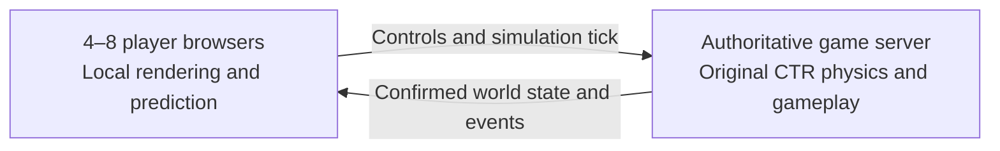

# Online 2.0: feasibility and architecture assessment

**Reviewed:** November 6, 2026\
**Status:** Feasibility, two-player prediction/correction, and power-up synchronization
prototypes (phases 1–3) implemented and automatically tested. Phase 3 also reduces
rollback cost and adds measured latency budgets. Live responsiveness/presentation
testing and broader interaction coverage remain necessary. The full Online 2.0
release and milestones 4–6 remain pending. See [implementation and measurements](ONLINE_V2.md).

## Scope

Version 1.0 uses one host simulation and streams its picture and audio to
guests. Version 2.0 would let each player run the game locally while a server
coordinates and authoritatively synchronizes the match.

- Support the existing multiplayer modes, including their physics and power-ups.
- Target four human players first, then assess and implement eight-player support.
- Leave Adventure unchanged. Originally solo modes are outside this online expansion.
- Assume each online player receives their own full-screen camera.
- Preserve the working streaming implementation as the 1.0 baseline.

## Feasibility

This is feasible, but it is a major engine and networking project. The
difficult part is keeping collisions, drifting, item pickups, weapons, and
race results consistent while every player runs their own game.

The preliminary planning scale is a **multi-month project**, with a smaller
feasibility prototype first. This is an engineering estimate, not a delivery
commitment. Timing should be revisited after measuring reproducibility,
state restoration, server performance, and network behavior.

## Recommended architecture

Each client applies its own controls immediately to keep driving responsive.
The server runs the original game simulation and decides the authoritative
result. Clients reconcile their predictions with those results.

Node can continue managing lobbies, with an isolated C/WebAssembly simulation
for each match. The original physics code should be reused in the server
simulation to preserve the driving behavior.

This is an established approach, but predicting interacting vehicles and
projectiles requires particular care. Showing an opponent slightly behind
its server position can affect how collisions and dodging feel.

Reference: [Client/server prediction and its interaction challenges](https://snapnet.dev/blog/netcode-architectures-part-3-snapshot-interpolation/).

## Existing foundations

The current code provides several useful starting points:

- Storage and simulation paths for eight racers.
- Physics and weapon logic available as C source.
- Replay support that records inputs, timing, and random state.
- Checkpoints that capture and restore substantial game state.
- A working browser build and lobby system.

These are foundations rather than a completed synchronization system.

Gameplay currently derives its elapsed time from the platform clock. The
online simulation needs a controlled tick schedule that preserves the
current driving feel. See [MainFrame.c](../game/MAIN/MainFrame.c).

Existing checkpoints also include pointer relocation, audio, and GPU state.
They are useful for rollback experiments, but networking needs a smaller,
portable representation of gameplay state. See
[native_checkpoint.c](../platform/native_checkpoint.c) and
[native_state.c](../platform/native_state.c).

## Eight racers versus eight human players

The current checkout still contains several four-player assumptions:

| System | Current evidence | Work required |
| --- | --- | --- |
| Racers | Eight driver slots | Useful starting point |
| Browser/controller bridge | Four controllers | Extend input ownership and mapping |
| Cameras and viewports | Four entries; Online 2.0 now selects one full-size local view | Extend camera/layout limits for eight humans |
| Character selection | Four-player logic | Network character selection and eight-player support |
| Battle | Four-entry player/team structures | Audit teams, scoring, targeting, and results |

Relevant sources:

- [native_input.h](../include/platform/native_input.h)
- [namespace_Main.h](../include/namespace_Main.h)
- [MM_Characters.c](../game/230/MM_Characters.c)
- [Battle and VS standings](../game/225.c)

The structs also preserve PS1 memory layouts. Expanding arrays can affect
unrelated fields and code that accesses fixed offsets. Eight-player support
therefore needs its own implementation and testing milestone.

## Physics and power-up synchronization

Sending position, rotation, and speed covers only part of the game. The
networked simulation also needs to synchronize:

- Drift state, boost reserves, jumps, terrain contacts, and vehicle collisions.
- Crate availability, Wumpa counts, inventory, ammunition, and item selection.
- Projectile creation, ownership, targets, movement, collisions, and destruction.
- Shields, masks, clocks, invisibility, explosions, and recovery timers.
- Moving hazards, bots, checkpoints, laps, standings, and battle scores.

For example, two players can reach the same item crate while their local
predictions disagree about who collected it. The server must choose one
result and correct both clients, including inventory and any weapon fired
from that predicted pickup.

Item selection uses shared random state, and some visual effects call the
same random-number function. Separating simulation from presentation
therefore requires a careful audit.

Relevant sources:

- [Item selection in VehPhysGeneral.c](../game/Vehicle/VehPhysGeneral.c)
- [Visual-effect random calls in VehStuckProc.c](../game/Vehicle/VehStuckProc.c)
- [Crate interactions and HUD updates in RB_Crate.c](../game/231/RB_Crate.c)

## Synchronization approaches to evaluate

| Approach | Benefit | Main difficulty |
| --- | --- | --- |
| Deterministic simulation with rollback | Reuses the complete interacting world | Identical simulation results, fast state restoration, and repeated simulation |
| Authoritative snapshots with selective prediction | Server can correct differences between clients | More explicit replication work; vehicle/projectile interactions need careful prediction |

The existing replay system makes rollback worth investigating. It does not
yet prove cross-browser determinism.

Full rollback requires saving/restoring state and advancing gameplay without
rendering. Presentation effects must also survive corrections cleanly.
Reference: [GGPO integration requirements](https://www.ggpo.net/).

The final method should be selected from prototype results rather than
solely from the existence of the replay system.

## Proposed development sequence

1. **Simulation feasibility prototype.** Run a headless server and two clients
   with controlled ticks. Measure reproducibility, snapshot size, restore
   speed, and simulation cost.
2. **Two-player race.** Preserve drifting, boosts, jumps, and kart collisions;
   add prediction and corrections.
3. **Complete power-up synchronization.** Include contested pickups,
   simultaneous hits, global effects, and hazards.
4. **All existing multiplayer modes at their supported player counts.**
   Include cups, bots, battle variants, teams, loading transitions, and results.
5. **Eight human players.** Extend the remaining limits and validate every
   affected mode.
6. **Network hardening.** Test latency, jitter, packet loss, slow clients, and
   disconnects.

The release gate should include **all multiplayer modes, all weapons, and
full physics**. Incremental prototypes are development milestones; they do
not reduce that final scope.

Local prediction can make driving responsive, but delayed server decisions
can still produce corrections during contested collisions or weapon hits.

## Recommended next step

Keep the working streaming version as the 1.0 baseline. The feasibility and
two-player rollback and power-up prototypes now provide measurements. Perform
live two-player responsiveness/presentation testing while extending coverage into
the remaining modes. Keep input response and correction cost as explicit gates
through subsequent work. The observations and local checkpoints do not establish
complete-world determinism or release-ready performance on all devices.

## Assessment limits

The original assessment was based on source-code inspection. The subsequent
feasibility prototype measured matching diagnostic observations across an
authority and two Node/WASM clients, same-worker checkpoint replay, and two
Chromium/WebGL2 clients. Phase 2 additionally tested original-game driving,
drifting, boosts, airborne state, kart-collision flags, and prediction/correction
under delayed confirmations and missed inputs. Phase 3 adds 44 controlled
normal/juiced inventory and interaction cases, rollback across all 18 VS tracks,
and delayed Chromium pickup/weapon/effect checks. See [ONLINE_V2.md](ONLINE_V2.md)
for exact coverage, latency measurements, and remaining gaps. Complete-world
determinism, every natural pickup/hazard encounter, cross-browser compatibility,
production bandwidth, and server capacity have not been established.
